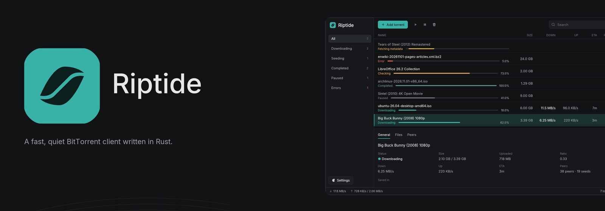
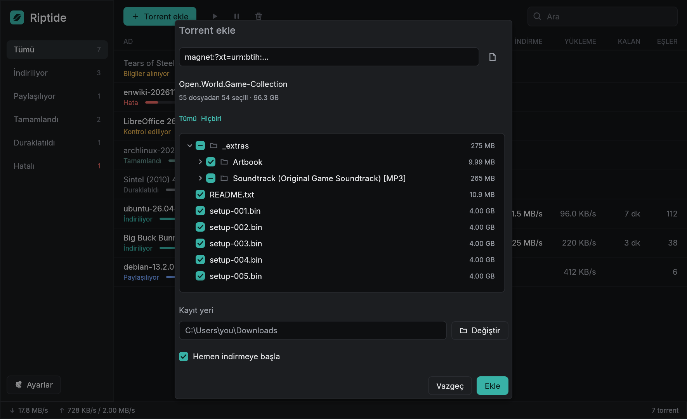
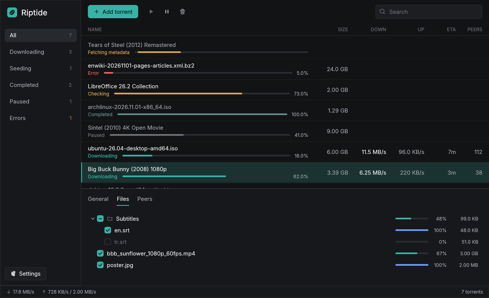
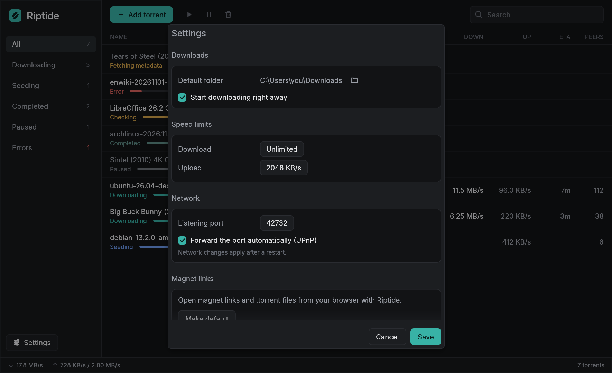

<p align="center">
  <a href="https://github.com/ethemdemirkaya/riptide/releases/latest"><b>Download for Windows</b></a>
  &nbsp;·&nbsp; <a href="#build-from-source">Build from source</a>
  &nbsp;·&nbsp; MIT licensed
</p>

Riptide is the torrent client you don't have to think about: paste a magnet
link, pick the files you want, done. It remembers everything between restarts,
picks up exactly where it stopped, and never asks you to configure ports or
trackers unless you want to.

## Features

- **Resume after restart.** Torrents continue where they left off, without
  re-checking data that is already finished.
- **Choose before you download.** The add dialog fetches the file list first.
  Folders collapse and can be selected as a whole.
- **Paste or drop.** Ctrl+V a magnet link anywhere in the window, or drop
  `.torrent` files on it.
- **Magnet links from the browser.** Make Riptide the default handler in
  Settings; links open in the window that is already running.
- **Speed limits** that apply instantly, plus UPnP port forwarding.
- **English and Turkish**, picked from your system language.
- One small native binary. No Electron, no web view, no OpenSSL.

| Add dialog | Files | Settings |
|---|---|---|
|  |  |  |

## Install

**Windows:** download `riptide_x.y.z_x64-setup.exe` from the
[latest release](https://github.com/ethemdemirkaya/riptide/releases/latest)
and run it. It installs for your user only (no administrator prompt) and adds
a Start menu entry. To open magnet links from your browser with Riptide, use
**Settings → Magnet links → Make default**. A portable `.zip` is attached too.

Linux and macOS: build from source for now.

### Build from source

```sh
cargo build --release
```

To build the Windows installer:

```sh
cargo install cargo-packager --locked
cargo packager --release      # writes target/installer/*-setup.exe
```

On Linux you need the GTK3 and xkbcommon headers
(`libgtk-3-dev libxkbcommon-dev` on Debian/Ubuntu).

## Keyboard

| Key | Action |
|---|---|
| Ctrl+V | Add the magnet link on the clipboard |
| Ctrl+N / Ctrl+O | Add torrent / open a .torrent file |
| Space | Pause or resume the selection |
| Delete / Shift+Delete | Remove / remove with files |
| Ctrl+A, Ctrl+F | Select all, search |

## Where things are stored

Settings and the session (torrent list and resume data) live in the platform
config and data folders. Set `RIPTIDE_HOME` to keep everything in one folder
instead, for example for a portable install. New torrents go to
`Downloads/Riptide` unless you pick another folder.

## Development

```sh
cargo test                                # unit tests
cargo test -- --ignored downloads         # end-to-end download + resume (needs network)
cargo test -- --ignored screenshots       # re-render docs/screenshots (needs a GPU)
```

The torrent engine is [librqbit](https://github.com/ikatson/rqbit); the
interface is [egui](https://github.com/emilk/egui).

## License

MIT. The bundled Inter font is under the SIL Open Font License
(`assets/fonts/Inter-LICENSE.txt`).
